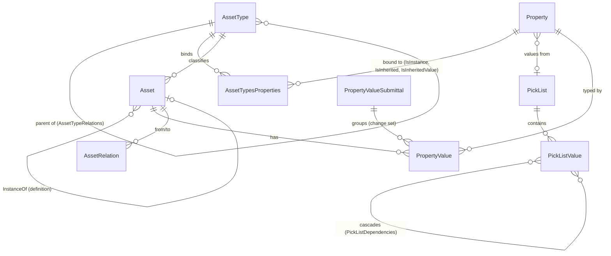

# 00 - The Original System, As I Understand It

**Purpose of this document:** to play back, in one place, what the original system (XDB v1) was and how it worked, so its author can confirm the rebuild starts from an accurate mental model. Sources: the original code snapshots (2010-2014), the de-branding attempts (2013-2015), and a copy of the production database (schema version ~v1506). Detailed evidence lives in the private excavation notes, not published.

Where the code and the live DB disagree, the live DB wins (it is what actually ran).

---

## 1. What it was, in one paragraph

XDB v1 was a **metadata-driven object repository with a generated user interface, a generated reporting layer, and generated row-level security**. An administrator described a domain - types of things, their attributes, how they relate, how they should be edited, who may see or change which subset of them - entirely as data. The system then *was* the application for that domain: forms, grids, search, filtered pickers, reports, dashboards, bulk Excel import/export, alerts, an approval workflow, and full value history, all without writing code. It was deployed as an IT asset lifecycle system (hardware, software, contracts, projects, people, locations), but nothing in the engine was asset-specific; "Asset" was simply the name for "object". At shutdown it held 50 types, 864 properties, 179 picklists, 104 roles, 170 reports, ~126k objects, ~1.6M current values and ~1.9M historical submittals.

## 2. The core idea: everything is an Asset of an AssetType

### 2.1 AssetTypes - a real type system
- Types form an **inheritance hierarchy** (`AssetTypeRelations` parent/child; up to 4+ levels: Hardware -> Mobile Device -> Cell Phone -> Smartphone -> Smartphone Model; Hardware -> Computer -> Laptop). Properties declared on a parent are inherited by children (`IsInherited`), and a report on a parent type is **polymorphic** - a "Hardware" report includes every laptop, monitor and switch.
- Some types are abstract (`AllowAssets` false: Hardware, Computer exist only to carry shared properties).
- Each type has display labels, pluralization, an icon, and default views.

### 2.2 Definition vs Instance - two-level modelling
The most distinctive design decision. Every type has two levels:
- **Definition** - the catalog/model record (a laptop *model*, a software *product*, a phone *model*). Labelled per type, e.g. "Product Code".
- **Instance** - a concrete, physical thing (*this* serial-numbered laptop assigned to *this* person). Labelled per type, e.g. "Asset Code". `Assets.InstanceOfId` points at its definition.

Each property is bound to one level per type. An instance automatically shows its definition's values as read-only inherited values (`IsInheritedValue`), so manufacturer, model specs, and product description are entered once on the definition and appear on every unit. Types that don't need two levels (User, Company, Contract, Software) simply have no instance label. Views, property groups, reports, permissions, process steps and the generated tables all carry an `IsInstance` flag.

### 2.3 Properties - reusable, typed attributes
Properties are global and reusable across types. ~26 data types:
- **Scalars:** String, Memo, HTML, Int, Float (precision), Currency (symbol + amount), Date, DateTime, URL (name + link), IPv4, IPv6, Geo.
- **Files:** Document, Image.
- **References:** PickList, User (optionally restricted to members of a Role), Asset (to a specific target type and level), and the relation types Relation_ParentChild, Relation_ChildParent, Dependency, Relation_Other - relations are *properties*, and approving a value materializes a row in `AssetRelations`.
- **System pseudo-properties:** the fixed columns of every asset (Name, Type, Description, InstanceOf, Created/By, LastModified/By, Deleted/By, DisplayValue) are exposed as properties with well-known GUIDs, so forms, filters and reports treat built-in and custom attributes identically. Writing to a system property updates the `Assets` row.
- Flags: multi-value (ordered), allow-new-values (inline creation from a picker), filtered reference lists, dependent property, sub-properties (reportable as `Assignee.Department`).

### 2.4 PickLists
Ordered values with colors, optional external sourcing (a picklist could be fed by a web service), and **cascading dependencies** (State -> County -> City; Job -> Subjob) via `PickListDependencies` and "Restriction" property triggers.

## 3. Changing data: submittals, approval, history

Values are **never updated in place**. Every save is a *submittal* (`PropertyValueSubmittals`) - a change set with notes and an auto-generated human-readable narrative. New `PropertyValues` rows are inserted against it; superseded single values are soft-deleted. A submittal is either auto-approved (by view flag or role permission) or waits for review; each value carries Approved/Rejected stamps. Consequences:
- Full per-field history for every object, and **point-in-time ("as of") reports**.
- A built-in review/approval workflow on any type, configured, not coded.
- Soft delete everywhere (`Deleted`/`DeletedBy`), with undelete and a separate hard "Kill".

Storage is EAV: `Assets` (fixed columns) + `PropertyValues(AssetId, PropertyId, Value nvarchar(max), Order, ...)`, with references stored as GUID strings and multi-values as multiple ordered rows.

## 4. The part that made it fast: metadata compiled into SQL

EAV is flexible and slow. The original system's answer - built in 2010-2012 on SQL Server 2008, years before "CQRS read models" was a common phrase - was to **compile the metadata into physical database objects**:

```mermaid
flowchart LR
    M[Metadata<br/>types, properties,<br/>reports, roles] -->|SqlDatabaseLayer<br/>generates DDL| G
    subgraph Source of truth
      E[(Assets +<br/>PropertyValues<br/>EAV)]
    end
    subgraph G[Generated objects - ~60% of the DB]
      PV[GUID-named pivot views<br/>scalar UDF per column]
      GT[gen&#123;Type&#125;_D / _I<br/>display columns]
      GR[gen&#123;Type&#125;_D_Raw / _I_Raw<br/>raw ids, GUID columns]
      SP[spr_gen..._Update<br/>MERGE one asset]
      RV[vwRpt_&#123;ReportId&#125;<br/>report = view]
      RL[vwRole_&#123;Role&#125;_&#123;Type&#125;_&#123;Perm&#125;<br/>row-level security]
    end
    E --> PV --> GT & GR
    E -->|on every save, for every type in the inheritance stack| SP --> GT & GR
    GT & GR --> RV
    GR --> RL
```

- **Per-type flat tables**, one per type per level: a decoded table (columns named by property display name, picklists/users/assets resolved to text - ready for grids and export) and a `_Raw` twin (columns named by property GUID, raw ids - for filtering).
- **A generated MERGE procedure per table** to refresh a single asset; on save the asset is pushed into the gen table of every type in its inheritance stack.
- **Reports are SQL views.** Saving a report emits `CREATE VIEW vwRpt_{id}` - a projection of the decoded table, filtered by a WHERE against the raw table. Running a report is `SELECT * FROM` the view.
- **Row-level security is SQL views.** Each role's per-type, per-permission filter (e.g. "Edit Laptops where Location = my region") becomes `vwRole_{role}_{type}_{permission}`; authorization is a membership check against that view.

Live DB counts: 178 gen tables, 178 refresh procs, 170 report views, 78 role views, ~107 pivot views - none of them in any script, all emitted at runtime.

## 5. Presenting data: everything is metadata, the client renders

- **View** = a screen for one type and level: ordered **PropertyGroups** (rendered as tabs), each an ordered list of properties, with **per-group overrides** for required, read-only and default value. The same property can be required on the "Request" view and read-only on the "Audit" view. Views also define captions, whether they allow creation/cloning/new values, auto-approval, and a filter defining which assets they apply to.
- **Process** = a guided, multi-step entry point on the Home page: answer filter questions -> resolve the asset type -> open a view in create or edit mode (e.g. "Request hardware").
- **The server never rendered forms.** It sent View -> PropertyGroup -> Property metadata as JSON; the jQuery client mapped each data type to a control (autocomplete pickers bound lazily through a single generic lookup endpoint, multi-value add/remove lists, currency pairs, file upload, CKEditor), tracked changes, enforced required/valid fields per tab, and posted a submittal envelope.
- Read mode turned every reference into a navigable link to the target asset's default view, plus a "related items" popup (who else references this / shares this value).
- **"[Enter New]"** let users create a missing picklist value, user, or referenced asset inline without leaving the form.
- **Relationship graph explorer:** from any asset, "Show item relationships" opened a radial graph (JIT/InfoVis RGraph) traversing reference properties across types and levels - e.g. Company -> Software products -> Releases/service packs -> individual machines with that release installed. Generic: any type linked to any other by any reference property was navigable as a graph, with no per-type code. This is the payoff of "relations are properties".
- **Related items** grouped as "<property> for N <plural type>", giving one-click traversal from a definition to all of its instances, or from a picklist value to everything sharing it.
- **@-mention tagging** in memo fields: autocomplete over any asset of any type, linking free text into the object graph.
- **Record locking**: an asset could be locked against edits and explicitly unlocked (context menu / action bar).
- Other surfaces: global search, favorites/bookmarks, recent items, My Info (everything related to me), a filter builder with AND/OR groups and saved quick filters, history timeline, prev/next navigation, print, admin "run as another user".

## 6. Reporting, dashboards, bulk data

- **Report builder:** pick type + level, add properties and sub-properties across references, reorder, group, filter with free-form logic (`1 AND (2 OR 3)`), add computed fields (Calculated, Concatenation, TimeElapsed, Range/Value labels), share with roles. Runs in a grid with paging, group-by, CSV export, as-of date, and execution stats.
- **Report results cache** (runtime shown, e.g. "from cache in 00:00.017"), runtime regrouping, grouping-preserving Excel export, and "Export for Update" feeding the bulk updater.
- **Charts as an exploration tool** (more than the code analysis suggested): pick type -> Definition/Instance -> group-by property -> Top N; a filter panel over every property including [No Value] buckets; three tabs over the same query - **Show It** (chart), **Map It** (Google Maps, via Lat/Lon on Address assets), **Prove It** (the rows behind the chart); clicking a bar opened the assets in that bucket.
- **Maps and dashboards:** site maps rolling up asset counts by type per location; dashboards as tabs of saved charts, each with its own filter.
- **Bulk upload/update:** generate a metadata-driven Excel template per type, upload, per-row logging; "export for bulk update" round-trip from a report. Gated by BulkUpload/BulkUpdate permissions, with BulkUpdate scoped by the Edit filter.

## 7. Security model

- Roles hold members, **per-type, per-level permissions** (Create, Edit, Delete, View, BulkUpload, BulkUpdate), each optionally narrowed by a row-level filter, plus grants for views, processes and reports.
- Global permissions for definitions vs instances and auto-approve.
- A User-typed property could be restricted to a role ("Assignee must be in IT Staff"); entering a user into a role-bound property added them to the role.
- Role filters supported a `CURRENT_USER` token, so the same role showed each member a different row set ("my assets", "my projects"). These per-request filters could not be precompiled into `vwRole_*` views and were evaluated at request time.
- Auto-approve could be granted per view within a role, not just globally.
- Identity was Windows Integrated auth mapped to `Members`; users were mirrored as `User` assets so people could be property values.

## 8. Automation and integration

- **Triggers / alerts:** Added, Modified, Deleted, *Becomes* (value transitions to X) and Restriction rules over types and property conditions; processed from unprocessed submittals. Not just admin-configured: **end users built their own alert subscriptions** in a 5-step wizard with a plain-English summary, delivered by email or on the home page as an "N new alerts" toast with acknowledge and pin.
- **Activity feed** on the home page with domain-specific narratives ("was assigned to", "returned to stock"), each opening a Submittal Summary of previous vs new values.
- **Windows service** with pluggable modules on a one-minute timer: job/project sync from an internal system of record, role <-> AD distribution-list reconciliation, user validation against the corporate directory, and ingestion of installed-software reports from a desktop agent.
- **Environment migration:** any asset or metadata item could be migrated DEV -> TEST -> PROD from the UI.
- Asset-confirmation "audit" campaigns: surveys generated from data, one question per property value per asset ("You are the <role> for X?"), with an admin "as seen by" view of any user's survey.
- In-app editable help with "Make a Suggestion" / "Report a Bug"; a WMI "asset interrogation" utility for querying remote machines.

## 9. What was genuinely powerful

1. **A complete application generator** whose unit of work was configuration: a new asset class with forms, security, reports and import went live in an afternoon with no deployment.
2. **Definition/Instance + type inheritance** - a richer and more correct model than most commercial CMDBs, which flatten "model" and "unit".
3. **Uniform treatment of system and custom attributes** - one filter, report and form engine for everything.
4. **History and approval as structural properties of the store**, not features bolted onto screens.
5. **The compiled read model** - EAV flexibility for writes, flat-table speed for reads and reports, and security expressed as set membership. A pattern that is now mainstream (projections / materialized views), done early and by hand.
6. **Per-context form semantics** (required/read-only per group per view) - the same data can be captured by different audiences with different rules.

## 10. Where the complexity and flaws were

Candidly, from the code and the data:

**Administration was hard.**
- An admin had to understand types vs levels vs inheritance, properties vs bindings vs group overrides, views vs processes, picklist dependencies, role permissions with filter-logic strings - across a dozen admin screens, with no preview, no impact analysis beyond a "consumers" panel, and no guard rails.
- Filter logic was free-text positional expressions (`(({0}) AND ({1})) OR ({2})`).
- Schema evolution left parallel tables (`RoleMembers`/`RolesMembers`, `RoleAssetTypes`/`RolesAssetTypes`, `TriggerTypes`/`lkTriggerTypes`, `Operators`/`lkOperators`) with only the code knowing which was live.

**The read model drifted.**
- Incremental per-asset refresh was automatic, but **regenerating gen tables and their procs after a metadata change was manual** - run from an NUnit "test" used as an admin script (`Utils/v1504.cs`). Add a property, forget the script, and reports silently lacked the column. A `FixAssetsMissingFromGenTables` routine exists for exactly this reason.
- Gen-table refresh was fire-and-forget on the thread pool with no retry.
- Pivoting relied on scalar UDFs per column per row - correct but expensive; DTA-generated indexes were bolted on directly in production.

**Typing and validation were thin.**
- Every value was a string; typed formatting lived in SQL UDFs; multi-values and currency used `^`-delimited encodings on the wire.
- Required/read-only enforcement was mostly client-side.

**Security had soft spots.**
- Many API operations trusted a client-supplied `userId`; the admin menu was gated by a hard-coded GUID in JavaScript.
- SQL built by string concatenation in several places; unescaped HTML (XSS) throughout the client; `eval` of grid column models; server endpoints returning HTML fragments.

**The codebase sprawled.**
- ~199k lines of C# across ~36 projects, two generations of the domain layer, three overlapping API surfaces (WCF SOAP, a 7.6k-line WCF REST file with ~297 operations, partial Web API 2, plus a mobile REST API).
- Corporate integrations, business-unit-specific code and the generic engine were interleaved.
- Tests (~590) were integration tests against a live database.

## 11. The resurrection attempts so far

| Attempt | When | What it did | Where it stopped |
|---|---|---|---|
| `XDB.*` (first de-branding) | 2013 | Namespace swap of the original projects | Hundreds of former-employer references remain; still depends on corporate DLLs |
| Second de-branding (same source tree) | Dec 2013 - Jul 2014 | Clean .NET 4.5 rewrite with a generic vocabulary (XObject, XObjectType, XProperty, XValue, XList, XUser, XRole, XSubmittal), "CO_" common-object procs, planned schema split (`core/data/sec/ui/gen/rpt/...`), a Node/socket.io spike | 255 `[Rework]` markers, none tested; rules engine a no-op; generic DAL throws `NotImplementedException` |
| `XDB Solution` (git, public on GitHub) | Dec 2014 | Fresh layering (Common/Models/Data/Domain), same generic vocabulary, still wrapping the original stored procs | 18 commits over 5 days; services project doesn't compile; no code generation ever started |
| Original repo, revisited (`Xdb.Core`, `Xdb.Web.Api`) | 2017-2019 | "trying to get this old thing running so i can fork it" - .NET Core 1.1/2.1 stubs | Stubs only |

The README vision for XDB - an object store that "periodically compile[s] code based from that metadata, deploy[s] that code into itself and continue[s] to operate" - was the natural next step from what the original system already did in SQL. It was never started in C#. The plan addresses whether it should be.

---

**Author review (2026-10-21):** confirmed "highly accurate". The UI baseline in production was the **jQuery View Engine** build in the original source tree. Sections 5, 6, 7 and 8 were extended afterwards from a review of screenshots of the running app (private excavation notes, not published).

Open questions:
- **"Transfer an asset"**: a to-do file in the original source tree mentions it ("hide transfer an asset on production"), but it appears in no code snapshot and none of the 108 screenshots (2012-2014), including all three generations of Home process lists. The nearest evidence is "assigned to" / "returned to stock" feed events and a submittal changing assignee, location and status together - consistent with a Process-driven transfer that was hidden on production.
- **Type hierarchy storage**: the live DB uses `AssetTypeRelations`; some code paths and the 2014 v2 AssetType editor (single "Parent Asset Type" field) suggest `AssetTypes.ParentId`. The DB is treated as authoritative for v1506.
- Which of the duplicate role/trigger/operator tables was the live one by v1506?
