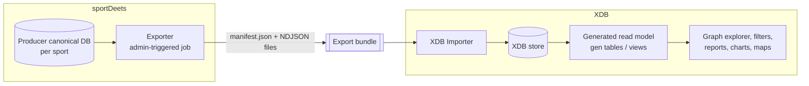

# 09 - Concept: XDB as a Link Explorer over sportDeets Data

Status: **concept (2026-10-21); first slices built, then paused (2026-10-26).** The import in `13-import-venue.md` reads the Producer database directly rather than through the export contract below; see `14-pause-point.md` for what exists. Sequencing: this comes *after* the as-is port in `10-plan-run-as-is.md` - the first version of this overlay runs on the resurrected engine, unmodified.

## 1. The idea

sportDeets has a deep, normalized, canonical sports dataset (franchises, seasons, athletes, coaches, venues, contests, polls, awards, drafts) going back 20+ years. sportDeets presents it through fixed, purpose-built screens for one job: pick'em. Nothing in sportDeets lets you **wander the data**: start at a coach and see every program, season and player they touched; start at a venue and see every team that played there; ask which players appeared for both of two rival programs.

XDB v1 was built for exactly that kind of wandering. Every reference property was a navigable link, related items were one click away, and the radial relationship graph drew multi-hop traversals - Company -> Product -> Release -> Machine - from metadata alone. Point that engine at sportDeets data and the same graph becomes Coach -> Programs -> Seasons -> Players -> Draft picks.

**Goal:** a read-mostly exploration tool over sportDeets canonical data, built on the XDB engine, showing links between objects that sportDeets' own UI never surfaces. Secondary goal: re-proving the "stores any object" claim on a second, non-asset domain (the first was a public aviation incident dataset import).

**Non-goals:** live sync, writing back to sportDeets, replacing any sportDeets screen, play-by-play or stat-line granularity, AI features.

## 2. Hard constraint: no direct access to Producer's database

XDB cannot read Producer's canonical database. This matches sportDeets' own rule (Producer is internal-only; even the sportDeets API reaches it over HTTP). Data moves by **export from sportDeets, import into XDB**. That decoupling is a feature: XDB stays independent of sportDeets' schema and deployment, and the same import path serves any other dataset.



## 3. Why the data fits the model unusually well

sportDeets' canonical model already has XDB v1's two-level **Definition / Instance** shape, built independently for its own reasons:

| sportDeets canonical | XDB type | Level | Notes |
|---|---|---|---|
| `Franchise` | Franchise | Definition | the program/team identity |
| `FranchiseSeason` | Franchise | Instance (`InstanceOf` -> Franchise) | one team in one season; record, rankings, ATS |
| `AthleteBase` | Athlete | Definition | the person |
| `AthleteSeason` | Athlete | Instance | the person on one team in one season (position, jersey) |
| `Coach` | Coach | Definition | |
| `CoachSeason` | Coach | Instance | the coach at one program in one season, with record |
| `GroupSeason` | Conference | Instance of a Conference definition | conference membership changes by season - realignment becomes visible |
| `Venue` | Venue | Definition | |
| `Location` | Address/Location | Definition | Lat/Lon -> **Map It** works immediately |
| `Season`, `SeasonWeek` | Season, Week | Definition | |
| `ContestBase` | Game | Definition | references home/away FranchiseSeason, Venue, Week |
| `SeasonPollWeekEntry` | Poll Ranking | Definition | references FranchiseSeason, poll, week |
| `Award`, `FranchiseSeasonAwardWinner` | Award, Award Winner | Definition | references AthleteSeason / FranchiseSeason |
| `Draft`, `DraftPick` | Draft Pick | Definition | references Athlete and the drafting franchise - **the NCAA -> NFL bridge**, if athlete identity links across sports (open question) |

Type hierarchy (XDB parent types, for polymorphic queries): `Person` -> {Athlete, Coach}; `Organization` -> {Franchise, Conference}; `Event` -> {Game}.

Every reference above is an XDB reference property, so every one is a graph edge, a related-items link, a filter dimension, and a report sub-property (`Game.Home.Franchise.Conference`) without further work.

### What the explorer would answer

- **Coaching trees and footprints:** Coach -> CoachSeasons -> FranchiseSeasons -> Athletes; overlay record by season.
- **Shared rosters / transfers:** athletes whose AthleteSeasons span two programs (portal-era movement made visible).
- **Draft pipelines:** Franchise -> Athletes -> Draft picks -> NFL franchises.
- **Conference realignment over time:** Franchise instances by season, grouped by conference.
- **Venue history:** every team and game at a venue; maps of where a program played.
- **Common opponents and rivalry webs:** Game edges between FranchiseSeasons.
- **Ranking trajectories:** a FranchiseSeason's poll entries over weeks (charts, as-of).

## 4. The export contract (XDB-owned, dataset-agnostic)

XDB defines the format; sportDeets is one producer of it, and the aviation incident dataset (or anything else) can be another.

**Bundle** = one directory or zip:

- `manifest.json`
  - `source` (e.g. `sportdeets:football-ncaa`), `exportedAt`, `batchId`, `formatVersion`
  - `types[]`: name, plural, parent type, levels (definition/instance), labels
  - `properties[]`: stable key, display name, data type (XDB `EDataType`), owning type + level, target type for references, picklist key, multi-value
  - `picklists[]`: key, values
- `objects/{type}.ndjson` - one line per object:

```json
{"type":"FranchiseSeason","externalId":"<canonical guid>","instanceOf":"<franchise guid>",
 "name":"<display name>","values":{"wins":10,"losses":3,"conference":{"ref":"Conference","id":"<guid>"}}}
```

Rules:
- **`externalId` is the sportDeets canonical id.** Imports are idempotent upserts keyed on `(source, type, externalId)`. XDB v1 already had the hooks: `Assets.DatastoreId` and the `Mappings` table used by its sync modules.
- **Each import is a batch**, recorded the way XDB v1 recorded a submittal. Re-importing next week yields value history per batch, so "as of import N" and per-field history work with the existing history UI.
- References resolve by `(type, externalId)`; unresolved references are reported, not fatal (sportDeets' own DLQ experience: dependencies arrive out of order).
- The manifest is applied first and is itself idempotent: new types/properties are created, existing ones matched by stable key, removals ignored (never auto-delete metadata).

## 5. The exporter (sportDeets side)

Options:

| Option | Pros | Cons |
|---|---|---|
| **A. Producer export job** (Hangfire job or admin endpoint, per sport) | Owns the data; one EF query per type with `.AsNoTracking()` projections; fast; can run against a prod-copy locally | A change to sportDeets during a feature pause (but read-only, isolated, admin-only - closer to tooling than a feature) |
| B. Standalone CLI calling existing API endpoints | Zero sportDeets code change | Limited to what the API exposes; slow (many calls); endpoints shaped for the UI, not bulk |
| C. CLI reading a **local copy** of Producer's DB | No sportDeets code change; fast | Couples the CLI to Producer's schema; only works where a DB copy exists; breaks the "never read Producer's DB" principle in spirit |

**Recommendation: A**, scoped to one sport mode at a time, run locally against a prod-copy first. Producer's schema is per-sport (`FootballDataContext`, baseball), so the bundle's `source` carries the sport.

## 6. The importer (XDB side), by phase

**Phase A - on the as-is engine** (immediately after `10-plan-run-as-is.md`):
- A console importer that writes `Assets` and `PropertyValues` directly with `SqlBulkCopy` in a single approved submittal per batch, then **regenerates the gen tables and views once** at the end.
- Do *not* go through the per-asset save path: each save refreshes gen tables for the whole type stack, which is fine for a person editing a form and hopeless for 100k+ objects.
- Requires the gen-table regeneration that XDB v1 only had as an NUnit "test" (`Utils/v1504.cs`) to become a real command. That is planned in the as-is work anyway (`10`, Phase 3).

**Phase B - after simplification** (later; not planned yet):
- Typed value table instead of string values: `property_value(object_id, property_id, value_text | value_number | value_date | value_bool | value_ref -> object | value_option -> picklist_value, ordinal, batch_id, superseded_at)`, with exactly one value column populated per the property's data type. Properties stay first-class and shared across types; **rows with `value_ref` are the graph edges** - no separate edges table.
- Graph traversal by recursive CTE over `value_ref` rows (or Apache AGE if traversal depth/perf demands it).

## 7. Scope and volume

The import should carry **graph-worthy entities**, not every canonical table. In: the types in §3. Out: plays, drives, stat categories/lines, odds, metrics, predictions, play analysis, outbox/inbox. Season statistics can come in later as a handful of summary properties on instances (e.g. passing yards on an AthleteSeason), not as their own objects.

Volume check before committing: count rows per in-scope type in a local prod-copy. XDB v1 ran comfortably at ~126k assets and ~1.6M values on 2012 hardware. sportDeets NCAA football with 20+ seasons of rosters may be a few hundred thousand AthleteSeasons - likely fine for the as-is engine with bulk import, but measure first. If it is too large, start with one conference or a decade.

## 8. First slice (end to end)

1. Exporter: Franchise, FranchiseSeason, Coach, CoachSeason, GroupSeason, Venue, Location for NCAA football.
2. Import into the as-is XDB; regenerate.
3. Demonstrate: a coaching-tree radial graph; FranchiseSeasons filtered by conference and season; a map of venues; a report of coach records by program.

Athletes, games, polls, awards and drafts follow once the slice works.

## 9. Open questions

1. Does sportDeets link an athlete's college identity to their NFL identity? (ESPN uses different athlete ids per league; the draft data may be the only bridge.)
2. Exporter option A vs B - acceptable to add an admin-only export job to Producer during the feature pause?
3. How often to re-import - one-off snapshots, or periodic batches to build history?
4. Where does XDB run - local only, or eventually alongside sportDeets on the cluster? (Affects whether SQL Server remains acceptable or Phase B moves to PostgreSQL.)
5. Naming - "XDB" or something new?
