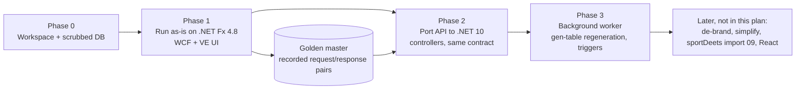

# 10 - Plan: Get the Original Running As-Is

Status (2026-10-21): **Phase 1 DONE.** The original 1.5.0.5 release build runs locally on Bender as the comparison oracle (jQuery View Engine UI unmodified, WCF REST on .NET Framework 4.8, against the working copy of the production backup). Six HAR captures were recorded as the golden master and are kept privately (they contain non-publishable data). **Phase 2 is next and not started.**

Principle (owner's): get the system working **as it was** - the jQuery View Engine UI unmodified, the same database, the same behavior - and only then simplify, de-brand, and build a React UI. The backend is the only part that must change, because its hosting stack (WCF + WCF REST Starter Kit) cannot move to modern .NET.

## 0. What the evidence says about the starting point

| Fact | Evidence | Consequence |
|---|---|---|
| Code baseline = the original source tree | It equals the 1.5.0.6 release snapshot except `Service.svc.cs`, 4 Core files and 17 View Engine files - the owner's 2017-2019 git commits ("trying to get this old thing running so i can fork it") | Start from the original git repo; its history is the owner's own. The release snapshot stays as the pristine reference. (Phase 1 was in the end run from the 1.5.0.5 release build.) |
| Database = the production backup (2013), restored on Bender | Release 1.5.0.6 <-> DB "1506" | Code and DB are the same version. |
| **Not** the later 1.6.0.0 solution tree (decided 2026-10-21) | It is release **1.6.0.0** (`AssemblyVersion("1.6.0.0")`, `Utils/v1600.cs`, edits to Dec 2014); v1600 writes HTML to `Processes`, a column the production backup lacks; the backup's newest hand-written proc is dated 2013-11-29, matching the original tree's last edits (Nov-Dec 2013); no jQuery View Engine in that tree | The 1.6.0.0 tree is a later, never-matched-to-this-DB version. Ignore it for the as-is run. |
| UI baseline = the jQuery View Engine build in the original source tree | Confirmed by owner | 2,411 files, static HTML/JS, ~324 call sites build URLs from `URL_REST_SVC` |
| Projects already target **.NET Framework 4.8** | `TargetFrameworkVersion v4.8` in Core, UI, External, Utils, REST | The 2017-2019 attempt already did the retarget. |
| **The Starter Kit dependency is one class** | Only `WebServiceHost2` in `REST/Service.svc` (10-line host factory: max message size, streamed transfer). All 314 operations use stock `System.ServiceModel.Web` attributes (`WebGet` 258, `WebInvoke` 56: 49 POST / 7 GET-via-invoke; 299 Bare, 15 Wrapped/WrappedRequest; 301 JSON, 10 XML; ~99 return `Stream`/`Message`) | WCF WebHttp is still in .NET Framework 4.8. Swap `WebServiceHost2` for the stock `WebServiceHost` + binding config, and the original service can run unchanged on 4.8. |
| UI also calls Web API 2 for 2 endpoints | `SVC_USER_GET = URL_WEB_API + '/UserClient/'`, `SVC_PICKLIST_GET = URL_WEB_ADMIN_API + '/PickList/'` | The Web API project and its admin twin are needed too (or those 2 calls re-pointed). |
| Corporate dependencies | Service references to internal directory/address-book, jobs and project-portfolio web services (Core, REST, Utils); corporate AD helper DLLs; a commercial PDF library; the 2002 Exception Management Application Block | Must be stubbed or removed; none are core to the engine. |
| Data access | `System.Data.SqlClient` in Core (43 files), UI (23), Utils (21); stored procs + inline SQL + runtime DDL | Works as-is on 4.8; mechanical swap to `Microsoft.Data.SqlClient` on .NET 10. |
| Local tooling | .NET Framework 4.8 targeting pack, VS 2022, .NET 10 SDK present. IIS / WCF HTTP Activation state unknown (needs an elevated check). | IIS Express is a fallback if full IIS isn't installed. |

## 1. The approach in one picture

**Phase 1 runs the original on .NET Framework 4.8 with minimal edits.** This is not wasted work: it gives a working reference system to record the exact wire contract against, so the .NET 10 port in Phase 2 can be verified by diffing responses instead of by eyeballing screens.

## Phase 0 - Workspace and data

**0.1 Repositories (DECIDED 2026-10-21)**
- **This repo is public** and holds only new code (`src/`) and these docs. The original source is never copied in: it carries the former employer's namespaces and vocabulary. It stays in its own local-only git repository and is used for reference.
- The port is written fresh against the recorded wire contract. Names, routes and identifiers in this repo are neutral; any legacy name the old UI requires on the wire lives in configuration, not in code.
- Credentials: none in source. Use local-only config (user secrets / untracked file) for connection strings. The old trees contain plaintext secrets and must not be mined for config.

**0.2a Run database (DONE 2026-10-21): the working copy on Bender** - a full copy of the production backup, verified identical (objects and row counts). The legacy app runs against this copy, never the original backup; the app emits DDL at runtime (report/role views, gen tables), so the copy is expected to drift. Golden-master recordings taken against it contain real data and stay private - never committed.

**0.2 Development database: a scrubbed clone of the production backup** (for fixtures and anything shared; not needed for the first as-is run)
- Never run against the production backup itself. Clone it on Bender as `XDB_Dev` (backup/restore).
- Scrub in the clone (script kept in the repo):
  - `Members` and `User` assets: replace names, emails, logins and badge numbers with generated values; keep ids so references hold.
  - Free-text values (`Memo`/`HTML`/`String` property values, submittal `Notes`/`Narrative`): replace with lorem text of similar length.
  - Truncate operational logs: `ServiceModuleLogs`, `BulkUploadLogs`, `Searches`, `AssetHits`, `MemberVisits`, `Errors`, `SqlLogs`, `DebugLogs`, `TriggerLogs`, `ReportLogs`, `StoredProcActivity`, caches.
  - Rebuild the gen tables from the scrubbed EAV, so the decoded copies don't retain old text.
- Keep all metadata (types, properties, views, roles, reports): the point of Phase 1 is fidelity. De-branding the metadata comes later.
- A metadata-only variant (all data removed, metadata kept) is a useful second database for checking that a fresh instance behaves.

**0.3 Map the local identity**
- Create or choose one admin `Member` mapped to the local Windows login (the app maps Windows identity to `Members`; the Admin role is a well-known GUID in `Constants.cs`).

**Exit:** public repo with no employer material and no secrets (original source kept local-only); working copy restored; local admin member. (`XDB_Dev` scrubbing deferred until shared fixtures are needed.)

## Phase 1 - Run the original on .NET Framework 4.8 - DONE (2026-10-21)

**Outcome:** the 1.5.0.5 release build runs locally on Bender with the jQuery View Engine UI unmodified (apart from its local URL config), against the working copy. Six HAR captures were recorded as the golden master and are kept privately. The steps below are retained as the record of the approach.

Scope = the projects the View Engine needs, nothing else:

| In | Out (for now) |
|---|---|
| Core, UI, External (stubbed), REST, Web API (+ its admin twin if needed for the 2 calls), `jQuery View Engine` | Gen 1 (`BusinessLayer`, `DataAccess`, `DataObjects`), `WcfServices` (SOAP), `RESTv2` (mobile), other web front ends, `ReportingWeb`, `WinService` + `SvcModules.*`, `WinAgent`, `Utils` (except gen-table regeneration code, see Phase 3), all test projects, setup projects |

Steps:
1. **Build first, change nothing.** Restore packages and build the in-scope projects as they are, and list every error. (Expected: missing Starter Kit assembly, missing corporate DLLs, missing service reference endpoints, missing commercial PDF library.)
2. **Starter Kit:** replace `WebServiceHost2` with `System.ServiceModel.Web.WebServiceHost` in the host factory. Move `MaxMessageSize` / `TransferMode.Streamed` into the `webHttpBinding` configuration (`maxReceivedMessageSize`, `transferMode`). Remove the `Microsoft.ServiceModel.Web` reference.
3. **Corporate dependencies:** replace with stubs behind the existing call sites. These are the address book / employee lookup (used by "[Enter New] user" and user validation), the AD wrapper (group membership operations), and the jobs/PPM services (Utils only). Stubs return empty or "not available". **No behavior in the engine depends on them.**
4. **Commercial PDF library:** stub the PDF export path (or drop the reference if unused by in-scope code).
5. **Exception Management Application Block:** keep it if the DLL is present in `Reference Files`; otherwise replace with a trivial logger shim.
6. **Config:** the app reads `appSettings` keys with an environment suffix (`key + LOCAL/DEV/...`). Supply a `LOCAL` set pointing at the local database, and SMTP to a local mail catcher (smtp4dev/Papercut) so triggers can fire safely.
7. **Hosting:**
   - REST service (`Service.svc`) and Web API in IIS (or IIS Express) with Windows authentication. Requires the IIS "WCF HTTP Activation" feature for full IIS (check from an elevated prompt).
   - View Engine as a static site. Set the `LOCAL` block in the UI's config script (`URL_CLIENT_UI`, `URL_REST_SVC`, `URL_WEB_API`, `URL_WEB_ADMIN_API`) to the local hosts.
   - Note that 22 UI calls are **synchronous** XHR (`async:false`); modern browsers still allow them on the main thread (with a console warning). Leave them alone in this phase.
8. **Smoke checklist:**
   - Home: processes, shortcuts, activity feed, alerts toast
   - Asset editor: open a view; read mode; links and related items; edit and save (submittal); create definition; create instance; clone; delete/undelete; history; prev/next; [Enter New] for a picklist value
   - Filter builder and quick filters
   - Reports: run predefined, as-of date, group-by, export; **report builder save** (must emit `vwRpt_*`)
   - Role admin: change a role filter (must regenerate `vwRole_*`); row-level security visible via run-as
   - Admin: edit an asset type, property, property group, view, picklist
   - Charts / Show It, Map It, Prove It; dashboards; **relationship graph**
   - Bulk upload: template generation and a small upload
9. **Record the golden master.** With the app working, capture request/response pairs for the operations the smoke checklist exercises (done as browser HAR captures), plus scripted calls for the remaining operations as needed. These define the wire contract for Phase 2.

**Exit:** the original runs on .NET Framework 4.8 with the VE UI unmodified, apart from its LOCAL URLs. Golden master recorded. **Met 2026-10-21.**

## Phase 2 - Port the API to .NET 10 with the same contract (next, not started)

Target: an ASP.NET Core (.NET 10) API that the **unmodified** View Engine can call in place of the WCF service, verified against the golden master.

**2.1 Business layer to .NET 10**
- Retarget Core and UI to `net10.0`. Expected changes:
  - `System.Data.SqlClient` -> `Microsoft.Data.SqlClient` (mechanical)
  - `System.Web` usages in UI (3 files) -> abstractions
  - EPPlus: keep the existing (pre-commercial-licence) version or switch to ClosedXML
  - Exception block -> `ILogger`
  - `DataSet`/`DataTable` work as-is on .NET 10
- No refactoring beyond what compilation requires. Static singletons, string SQL and the ADO.NET DAL all stay as they are for now.

**2.2 API surface**
- Controllers grouped by the old operation prefixes (Asset, Assets, AssetType, Property, PropertyValues, Report, Role, View, ...). **Routes are the literal WCF `UriTemplate`s** (e.g. `[HttpGet("Service.svc/DictionaryValues_GetForProperty")]` with query binding), so `URL_REST_SVC` keeps pointing at `.../Service.svc`.
- Each action is a thin call into the same business-layer method the WCF operation called. This is mechanical across 314 operations; it can be largely generated from the `[WebGet]`/`[WebInvoke]` attributes.
- Fold the 2 Web API 2 endpoints in as well, so the UI talks to one host.

**2.3 Wire compatibility - the critical detail**
WCF serialized with `DataContractJsonSerializer`, which differs from `System.Text.Json` in ways the jQuery code depends on:
- `"\/Date(1356998400000)\/"` dates
- `[DataMember]` names, and casing as declared
- dictionaries as `[{"Key":..,"Value":..}]` arrays
- enums as numbers
- Bare vs Wrapped bodies
- `Stream` responses written raw
- 10 XML-format operations

Recommendation: **use `DataContractJsonSerializer` itself** (still available in .NET 10, `System.Runtime.Serialization.Json`) through custom ASP.NET Core input/output formatters, so the output is byte-compatible rather than approximately compatible. Handle the 15 Wrapped/WrappedRequest operations and the `Stream` operations explicitly.

**2.4 Auth**
ASP.NET Core Negotiate (Windows) authentication locally, mapping the Windows identity to `Members` exactly as before. The client-supplied `userId` trust model stays **as-is** in this phase (documented risk; fixing it is a simplification-phase item).

**2.5 Verification**
- Replay the golden-master captures against both the original and the new API and diff the responses, normalizing ids and timestamps where the data changed.
- Rerun the Phase 1 smoke checklist with the VE pointed at the new API.
- The ~590 legacy NUnit integration tests are a behavior spec. Port the ones covering Core / UI against `XDB_Dev` if useful, but don't block on it.

**Exit:** the VE UI runs entirely against the .NET 10 API; checklist passes; golden-master diff clean. WCF and .NET Framework retired.

**Rough effort:** 1-3 weeks. Dominated by the 314 actions (mostly mechanical) and serialization edge cases.

## Phase 3 - Background work, done properly

The original ran these from a Windows service timer, from fire-and-forget thread-pool work, or **by hand**:
- **Gen-table and view regeneration on metadata change.** Originally an NUnit "test" used as an admin script (`Utils/v1504.cs`), the root cause of read-model drift. Make it a real command: admin endpoint + .NET 10 Worker Service, idempotent, with a drift check (compare each type's properties against its gen-table columns). It is also a prerequisite for bulk import (`09`, §6).
- **Per-asset gen refresh** after save: keep the existing behavior, but run it through a queue with retry instead of the thread pool.
- **Trigger/alert processing and notifications:** Worker Service, SMTP to the local catcher.
- **Drop:** JobSync, DistroSync, UserValidation, AgentReport, WMI discovery (corporate or obsolete).

**Exit:** a metadata change (add a property to a type) appears in grids, reports and role views with no manual step.

## Explicitly later (not in this plan)

De-branding namespaces and metadata; simplification (typed values, removing duplicate tables, server-side validation and auth fixes); PostgreSQL; the sportDeets exporter/importer (`09`); React UI.

## Decisions

1. **Phase 1 on .NET Framework 4.8 first, or straight to .NET 10?** Decided: 4.8 first - done. The Starter Kit blocker was one class, and a running original is the only reliable oracle for the port.
2. **Repo (DECIDED 2026-10-21):** fresh public repo with new code only; original source stays local-only.
3. **Dev data:** scrubbed clone of the production backup (recommended for fidelity), metadata-only, or both?
4. **Hosting locally:** full IIS (needs the WCF HTTP Activation feature enabled) or IIS Express?
5. **The 2 Web API 2 endpoints:** fold them into the .NET 10 host in Phase 2, or re-point those 2 UI calls at equivalent WCF operations?

## Risks

| Risk | Mitigation |
|---|---|
| Build failures beyond the predicted set (missing third-party DLLs not in `Reference Files`) | Phase 1 step 1 is "build and list errors" before any change; NuGet equivalents exist for most (EPPlus, SharpZipLib, Newtonsoft) |
| Runtime DDL needs elevated SQL permissions (CREATE VIEW/TABLE/PROC) | Dev login is `db_owner` on the local databases only |
| Serialization mismatches break the jQuery UI silently | DataContractJsonSerializer formatters + golden-master diff |
| Real personal data leaking into the repo or fixtures | Golden-master captures, the legacy deployment and DB files stay private and are never committed; shared fixtures only from scrubbed `XDB_Dev` |
| Scope creep into simplification during the port | The rule: Phases 1-2 change only what is needed to compile and host |
| The fifth restart stalls like the first four | Phase 1 produced a visibly working system; each phase has a concrete exit |
